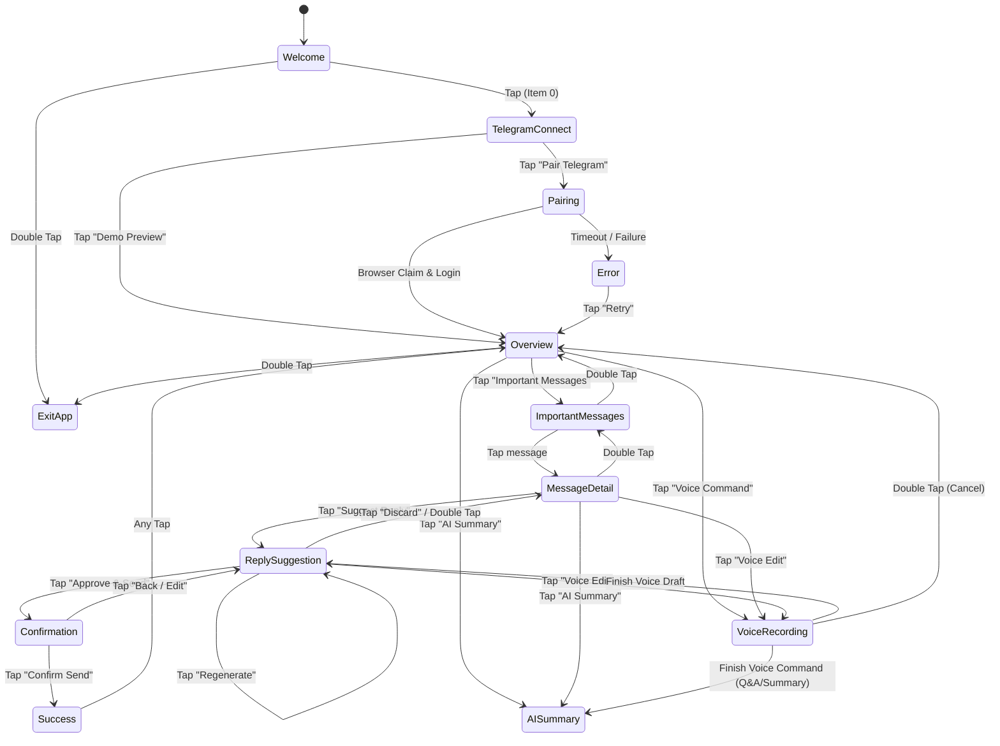
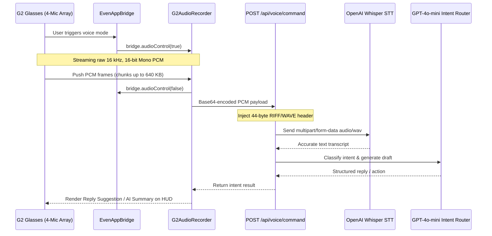

# Architecture: Telegram AI Copilot for Even Realities G2

This document provides a comprehensive technical breakdown of the architecture, subsystems, data flows, and design decisions behind **Telegram AI Copilot** for the Even Realities G2 smart glasses.

---

## 1. System Topology

```mermaid
flowchart TD
    subgraph G2["Even Realities G2 Hardware & Runtime"]
        HW["Temple Touchpad / R1 Ring / 4-Mic Array"]
        BRIDGE["Even App Bridge (BLE Transport)"]
        WEBVIEW["G2 App WebView (576x288 HUD)"]
        SM["Controller State Machine (12 Screens)"]
        DISP["G2DisplayEngine (Flicker-Free Upgrades)"]
        REC["G2AudioRecorder (16 kHz PCM)"]

        HW -->|BLE Events| BRIDGE
        BRIDGE -->|Sys/Text/List Events| SM
        BRIDGE -->|Raw PCM Packets| REC
        SM -->|Layout Definitions| DISP
        DISP -->|Create/Upgrade/Rebuild| BRIDGE
    end

    subgraph Companion["Companion Device (Mobile / Desktop)"]
        PORTAL["/setup Browser Portal"]
    end

    subgraph Backend["Fastify Backend Server (Port 3001)"]
        AUTH["Pairing & Auth Service (AES-256-GCM)"]
        TG_SRV["Telegram MTProto Service (GramJS Pool)"]
        PRIOR["Priority Scoring Engine"]
        AI_SRV["AI Copilot Service (GPT-4o-mini)"]
        VOICE_SRV["Voice Transcoder (WAV + Whisper)"]
    end

    subgraph Storage["Persistence Layer"]
        PG[("PostgreSQL 14+\n- users\n- user_sessions\n- pairing_codes\n- monitored_chats\n- message_cache")]
    end

    subgraph External["External Cloud Services"]
        TG_CLOUD["Telegram MTProto Datacenters"]
        OAI["OpenAI API (Whisper + GPT-4o-mini)"]
    end

    WEBVIEW -->|HTTP / JSON (Bearer Token)| Backend
    PORTAL -->|Pairing Claim & OTP Login| Backend
    AUTH <--> PG
    TG_SRV <--> PG
    TG_SRV <--> TG_CLOUD
    AI_SRV <--> OAI
    VOICE_SRV <--> OAI
```

---

## 2. Even Realities G2 Display & Hardware Constraints

### 2.1 Optical & Spatial Budget
- **Display Resolution:** Dual micro-displays rendering a green monochrome viewport of **576 pixels wide by 288 pixels high**.
- **Visual Glancing Window:** Because the user reads this while walking, commuting, or in meetings, content must be consumable within a 1 to 2 second glance.
- **Line & Character Budget:**
  - Standard monospace / sans font on G2 comfortably accommodates **36 to 38 characters per line**.
  - Maximum body text lines: **3 lines**. Exceeding 3 lines causes eye fatigue and vertical clipping on the HUD.
  - All summaries, translations, and message previews are strictly clamped using `formatGlanceLines(text, 3, 38)`.

### 2.2 Container System & SDK Limits
The official `@evenrealities/even_hub_sdk` imposes strict hardware container boundaries:
- **Max total containers per page:** 12 containers.
- **Max text containers:** <= 8.
- **Max list containers:** <= 4.
- **Max image containers:** <= 4.
- **Container byte size on create/rebuild:** <= 999 UTF-8 bytes.
- **Text container size on upgrade:** <= 1,999 UTF-8 bytes.
- **List item text size:** <= 63 UTF-8 bytes per item.

### 2.3 Layout Architecture: 3 Primitive Patterns
The application standardizes on 3 high-performance layout primitives:

1. **Text Layout (`kind: 'text'`):**
   - Header (ID 1, y: 4, height: 32)
   - Body (ID 2, y: 38, height: 210)
   - Footer (ID 3, y: 254, height: 30)
   - *Optimization:* Transitions between text screens (e.g., Welcome → Error) utilize `textContainerUpgrade` rather than page rebuilds, eliminating HUD flicker.

2. **List Layout (`kind: 'list'`):**
   - Header (ID 1, y: 4, height: 32)
   - List Container (ID 4, y: 38, height: 210, up to 6 visible items)
   - Footer (ID 3, y: 254, height: 30)
   - Used for the Overview menu, Important Messages list, and Select options.

3. **Split Layout (`kind: 'split'`):**
   - Header (ID 1, y: 4, height: 32)
   - Preview Text (ID 5, y: 38, height: 80, previewing incoming message or draft)
   - Action List (ID 4, y: 122, height: 128, actions such as "Approve & Send", "Regenerate")
   - Footer (ID 3, y: 254, height: 30)
   - Used for Message Detail, Reply Suggestion, and Confirmation screens.

### 2.4 Protobuf Wire Zero-Omission Normalization
In protobuf serialization over BLE:
- Enum `CLICK_EVENT` has integer value `0`.
- List index `0` (the first list item) has integer value `0`.
In standard Protocol Buffers, default zero values are omitted from the wire. When decoded in the WebView, `sysEvent.eventType` or `listEvent.itemIndex` arrives as `undefined`.
- **Solution (`src/g2/input.ts`):** The input normalizer checks for the existence of active event envelopes (`sysEvent`, `listEvent`, `textEvent`). If `sysEvent` is present with `eventType === undefined`, it safely maps to `CLICK_EVENT` (single tap). If `listEvent` is present with `itemIndex === undefined`, it safely maps to index `0`.

---

## 3. Finite State Machine (12 Screens)

The G2 frontend is driven by a deterministic finite state machine (`CopilotController`) with a navigation history back-stack (depth 16):



---

## 4. Backend & Telegram MTProto Integration

### 4.1 Zero-Credential Boundary
No Telegram app credentials, phone numbers, OTP codes, or MTProto string sessions ever enter the G2 WebView. The glasses store only an opaque 64-character bearer token in local storage.

### 4.2 GramJS MTProto Client Pool
- **Module:** `apps/backend/src/services/telegramService.ts`
- **Session Decryption:** When a request arrives from a paired G2 device, the backend fetches the encrypted `session_string` from PostgreSQL, decrypts it using AES-256-GCM with `DATABASE_ENCRYPTION_KEY`, and connects via GramJS `TelegramClient`.
- **Connection Reuse:** Active `TelegramClient` instances are cached in memory with a 15-minute inactivity TTL.
- **Flood Wait Defense:** MTProto API calls wrap GramJS `RPCError` handling, catching `FLOOD_WAIT_X` and surfacing clean backoff notifications without crashing.

### 4.3 Intelligent Priority Scoring
- **Module:** `apps/backend/src/services/prioritizer.ts`
- Telegram messages are evaluated across multiple heuristic dimensions:
  1. **Direct Questions (`score += 40`):** Detects question marks and question openers (*Can you*, *Could you*, *Are we*, *What time*, *When*, *Where*).
  2. **Urgency Indicators (`score += 35`):** Regex matches (*asap*, *urgent*, *deadline*, *review*, *approve*, *blocker*, *prod*, *down*).
  3. **Direct 1:1 Messages (`score += 20`):** Private chats prioritized over large public channels.
  4. **Monitored Chat Priority (`score += 15`):** Explicitly favorited chats.
  5. **Time Recency Decay:** Multiplies raw score by `1 / (1 + age_in_hours * 0.25)`.
- Messages exceeding a threshold of 60 are categorized as `URGENT` or `HIGH` priority and presented in the glanceable list.

---

## 5. AI Engine & Prompt Engineering

### 5.1 Architecture
The AI engine (`apps/backend/src/services/aiService.ts`) interacts with OpenAI's `gpt-4o-mini` using strict JSON schema output modes (`response_format: { type: "json_object" }`).

### 5.2 Clamping & Formatting Pipelines
LLM responses are post-processed through a dual-stage clamp:
1. **Server-side Line Clamper (`clampG2Lines`):** Splitting sentences at natural punctuation boundaries, wrapping lines at 38 characters, and truncating to exactly 3 lines.
2. **Client-side Byte Guard (`truncateUtf8Bytes`):** Ensuring no container receives more than its hardware byte allowance.

### 5.3 Intent Classification Pipeline
Voice transcripts captured on G2 are evaluated to detect user intent:
- `read_important` → User asks to see high-priority messages.
- `summarize_chat` → User asks for an executive summary of a specific chat.
- `draft_reply` → User speaks a proposed message or response.
- `ask_context` → User asks a factual question about chat history ("*Where did Sarah say the dinner is?*").
- `translate_msg` → User asks to translate an incoming message.

---

## 6. Voice Pipeline & PCM Transcoding



- **Transcoding Utility (`encodePcm16kMonoToWav`):** Injects a canonical 44-byte RIFF/WAVE header into the raw 16,000 Hz, 16-bit, mono PCM stream, producing standard WAV audio compliant with Whisper STT requirements without external FFmpeg dependencies.

---

## 7. Storage Architecture & PostgreSQL Schema

The backend utilizes PostgreSQL 14+ with strict relational integrity:

1. `users`: Master user record with status and created/updated timestamps.
2. `user_sessions`: Bearer token hash (`sha256`), expiry timestamp, and user association.
3. `pairing_codes`: Ephemeral 6-character uppercase codes with a 10-minute validity window.
4. `telegram_accounts`: User's Telegram ID, phone number, and AES-256-GCM encrypted `session_string`.
5. `monitored_chats`: Chat IDs explicitly enabled by the user with importance weights and allowlist flags.
6. `message_cache`: Local cache of synced messages with priority scores, question flags, and sender details.

---

## 8. Summary of Technical Specifications

| Parameter | Specification |
| :--- | :--- |
| **Display Model** | Even Realities G2 (Dual Micro-LED, Monochrome Green) |
| **Display Resolution** | 576 × 288 px |
| **Glance Budget** | 3 lines max, 38 chars/line max |
| **Max Containers** | 12 total (<= 8 text, <= 4 list, <= 4 image) |
| **Audio Input** | 4-microphone array, 16 kHz mono 16-bit PCM |
| **Mobile Companion** | Responsive HTML5/TS portal at `/setup` |
| **Encryption Standard** | AES-256-GCM with PBKDF2 key derivation |
| **Backend Runtime** | Node.js 22 + Fastify 5.x + TypeScript 5.x |
| **Telegram Protocol** | GramJS MTProto v2.0 |
| **Speech-to-Text** | OpenAI Whisper-1 |
| **Language Model** | OpenAI GPT-4o-mini |
| **SDK Version** | `@evenrealities/even_hub_sdk` v0.0.16 |
| **Package Format** | Even Hub Package (`.ehpk`, 39,336 bytes) |
